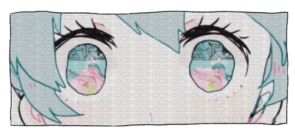

# hello there!!

  <h2>I'm Alina, a Systems Engineering Student!</h2>
  

I like figuring out how things work, taking things apart (conceptually... mostly), and turning little ideas into things that actually work. I love exploring the world of software, experimenting with different technologies, and finding the logic behind everyday things.

You'll find a little bit of everything around here: projects, experiments, things I'm learning, and probably a few happy accidents along the way.

Currently learning, building, breaking things, and putting them back together.

hope you find something interesting!

## A little bit about me

- fluent in spanish & english, currently learning japanese!
- i enjoy working with javascript, css, vue.js, and node.js
- big fan of creative things: music, anime, books, videogames, and pretty much anything that sparks inspiration :)

---

## Technical Skills

### Languages

### Frameworks & Libraries

### Backend & Databases

### Tools

---

## Featured Projects

### Miga — Document Management Platform
A web-based document management platform developed for a non-profit organization as part of a collaborative university project.

**My Contributions:**

- Developed an interactive landing page featuring project information, GSAP animations, and interactive UI elements.
- Implemented document browsing, keyword search, filtering, and favourites functionality.
- Developed user-management, citizen-proposal, and reporting interfaces, including PDF report generation.
- Integrated frontend modules with REST APIs using Axios and JWT authentication, while implementing responsive layouts.

**Tech:** Vue.js, Vuetify, Axios, PostgreSQL.

[View Repository](https://github.com/Osorio-Raquel/New-Jeans-Front.git)

### Xaquikserit@ — Fair Navigation Application
A web application designed to help visitors navigate a fair, developed as a collaborative university project.

**My Contributions:**

- Collected and manually mapped vendor locations and pedestrian paths to create a structured representation of the fair.
- Implemented route selection using Dijkstra's algorithm, incorporating geographic distances and pedestrian safety considerations.
- Developed route reconstruction and visualization, displaying calculated paths through Leaflet.
- Contributed to the application's landing page and interface components.

**Achievement:** Awarded 2nd place at a university project exhibition.

**Tech:** Vue.js, Leaflet, JavaScript.

[View Repository](https://github.com/Osorio-Raquel/Xaquikser-.git)

### CoCal — Collaborative Calendar
A mobile application for managing shared events, groups, and social connections, developed as a collaborative university project.

**My Contributions:**

- Designed application screens, wireframes, and interactive prototypes using Figma.
- Implemented a customizable theming system with light/dark modes, accent colors, and font selection.
- Developed friendship management functionality, including user discovery and friend requests.
- Integrated friendship verification and privacy-related logic across the application.

**Tech:** Flutter, Dart, Supabase, Figma.

[View Repository](https://github.com/SaiPlusSai/Cocal-Personal.git)

---

thanks for passing by!!

